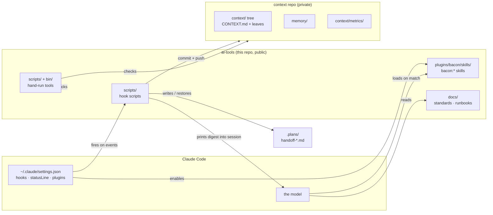
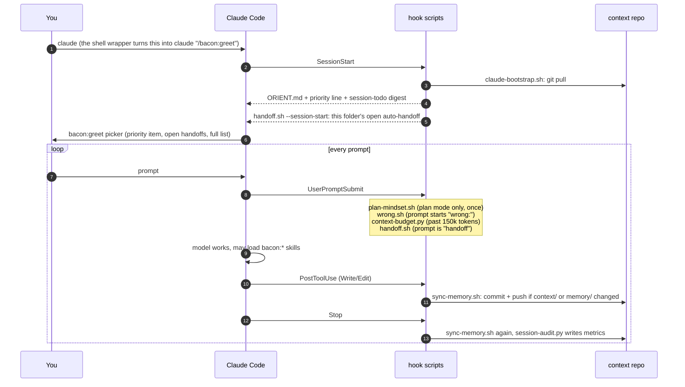
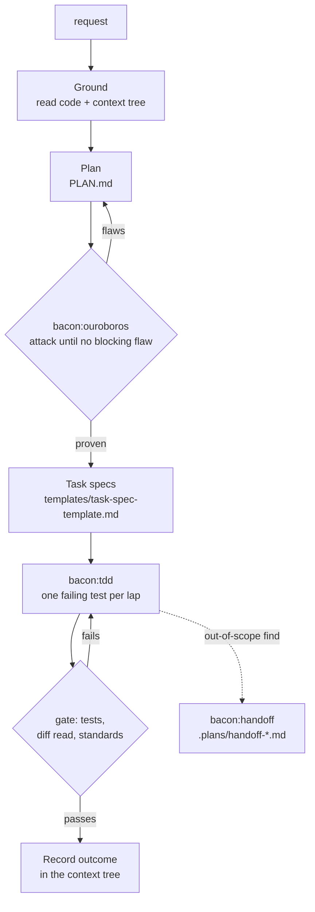

# Harness map

Every file in this repo: what it does, when it runs, and what to edit to change a given behaviour.
The diagrams render on GitHub. For a clickable version with more detail on each file (a detail
panel, a session timeline, a search box and an "I want to change…" finder), open
[`harness-map.html`](harness-map.html) in a browser.

> Paths are written as `<workspace>/…`. The real root is `~/www` (Mac/Linux), `/mnt/www` (WSL2)
> or `M:\` (Windows); `scripts/lib-root.sh` works out which.

`scripts/health-check.sh` fails if a tracked file is missing from this page or from the HTML one, so
adding a file means adding a row here.

---

## The harness in one paragraph

Claude Code does the work. This repo changes how it behaves, in four ways:

1. **Hooks**: shell and Python scripts that Claude Code runs on its own at fixed moments (session start,
   each prompt, each file edit, end of each reply). They are wired in `~/.claude/settings.json`.
2. **Skills**: Markdown instructions the model loads when a request matches them, shipped as one
   plugin named `bacon`, so they are invoked as `bacon:<name>`.
3. **Tools**: scripts run by hand or by a scheduler (the health check, the installer, `now`).
4. **Docs**: the rules every session works to (coding standards, prompting runbooks).

What the harness *remembers* is kept out of this repo, in a separate private **context repo**: the
context tree, memory, metrics and plans. This repo is public and holds no personal data.

---

## The shape in one picture



---

## A session, start to finish

What fires, in order. Every hook here is wired in `~/.claude/settings.json`; `scripts/install.py`
writes that wiring for a new machine.



The status line at the bottom of the terminal is `scripts/priority-line.sh`, re-run continuously.

---

## Where things live

```
ai-tools/
├── .claude-plugin/marketplace.json   the marketplace Claude Code installs the plugin from
├── plugins/bacon/                    the plugin: skills invoked as bacon:*
│   ├── .claude-plugin/plugin.json
│   └── skills/<name>/SKILL.md        one folder per skill
├── scripts/                          hook scripts, helpers and hand-run tools
├── bin/now                           on PATH, callable as `now`
├── config/delegation.yaml            tier → model sketch for the local agent (not live)
├── templates/                        task-spec, spike, launchd job
├── docs/                             this page, standards, runbooks, setup
├── .env.example                      every machine-local setting, documented
└── README.md                         principles and the four-phase workflow
```

---

## Every file

### Plugin and skills (`plugins/bacon/`)

A skill is a Markdown file the model reads when a request matches its description. Its
`description:` frontmatter decides when it triggers, so that line matters most when you edit one.

| File | Skill name | What it does | Edit it to… |
|---|---|---|---|
| `.claude-plugin/marketplace.json` | — | Declares this repo as the `ai-tools` marketplace holding one plugin, `bacon`. | rename or add a plugin |
| `plugins/bacon/.claude-plugin/plugin.json` | — | The plugin's name, version and description. | bump the version |
| `plugins/bacon/skills/architect/SKILL.md` | `bacon:architect` | The default path for any code change: ground → plan → ouroboros → task specs → TDD build, with a gate between each. Sequences the other skills; invents no planning logic of its own. | change the pipeline's phases or gates |
| `plugins/bacon/skills/ouroboros/SKILL.md` | `bacon:ouroboros` | Two-role adversarial planning loop: a planner and an attacker revise the plan until neither finds a blocking flaw, then a separate verifier certifies it. Writes `PLAN.md`. | change how plans are challenged or the convergence rule |
| `plugins/bacon/skills/tdd/SKILL.md` | `bacon:tdd` | Red → green → refactor, one failing test per lap; includes a Laravel/Pest section. | change test-first rules |
| `plugins/bacon/skills/handoff/SKILL.md` | `bacon:handoff` | When an out-of-scope problem turns up mid-task, write a plan for it in `.plans/` and hand it off instead of fixing it inline. | change the handoff plan template |
| `plugins/bacon/skills/second-brain/SKILL.md` | `bacon:second-brain` | Deep engineering mode: orient in code and memory, plan, build with verified steps, record decisions. | change the engineering-mode phases |
| `plugins/bacon/skills/git-conflict/SKILL.md` | `bacon:git-conflict` | Resolving conflicts from concurrent agents or worktrees, including conflicts in the context repo (reconcile ideas, never pick a side silently). | change conflict procedure |
| `plugins/bacon/skills/greet/SKILL.md` | `bacon:greet` | Session opener: reads the startup digest and offers at most four picker options in a fixed order. | change what the opening picker offers |
| `plugins/bacon/skills/context-query/SKILL.md` | `bacon:context-query` | "Latest / since <date>" questions about the context tree: the date is in the file name, so it is a sort, never a text search. | change when date queries trigger |
| `plugins/bacon/skills/context-query/context-query.py` | (used by `bacon:context-query`) | `latest N`, `since <date>`, `find <name>` over leaf file names; has `--self-check`. | change date parsing |
| `plugins/bacon/skills/ai-tools-context/SKILL.md` | `bacon:ai-tools-context` | Loads or updates the context tree on request, for installs that do not bootstrap it automatically. | change the manual load/update steps |

### Hook scripts (`scripts/`, fired by Claude Code)

| File | Fires on | What it does | Edit it to… |
|---|---|---|---|
| `scripts/claude-bootstrap.sh` | SessionStart | Pulls the context repo, then prints `ORIENT.md`, the priority line and the `session-todo.sh` digest. SessionStart output lands in the model's context. | change what every session starts knowing |
| `scripts/handoff.sh` | SessionStart, UserPromptSubmit | At start, restores this folder's open `handoff-auto-<folder>.md`. On a prompt of `handoff [topic]`, prints that plan verbatim. | change how plans are found or restored |
| `scripts/plan-mindset.sh` | UserPromptSubmit | In plan mode only, once per session, injects `PLANNING-MINDSET.md` from the context repo. | change plan-mode priming |
| `scripts/wrong.sh` | UserPromptSubmit | A prompt starting `wrong:` is appended verbatim to the failure log before the model sees it. | change failure-log format |
| `scripts/context-budget.py` | UserPromptSubmit | Reads the transcript; past 150,000 tokens it tells the model to write the automatic handoff. | change the token threshold |
| `scripts/sync-memory.sh` | PostToolUse (Write/Edit), Stop | Commits and pushes the context repo when a file under `context/` or `memory/` changed; regenerates indexes with `context-index.sh` first. | change what gets auto-committed |
| `scripts/session-audit.py` | Stop | Turns the transcript into one metrics row (`sessions.tsv`) and queues the rare signals that need a verdict (`candidates.md`). Never reads your message text. | add a metric |
| `scripts/priority-line.sh` | statusLine (and SessionStart) | One line: progress on the priority checklist and its next item. | change the status line |

### Helpers (called by other scripts)

| File | Called by | What it does |
|---|---|---|
| `scripts/lib-root.sh` | session-todo, health-check, priority-line, context-check-monthly | Sourced, not run. Finds the workspace root on each OS and loads `.env`. |
| `scripts/session-todo.sh` | claude-bootstrap, health-check | The "Still open" digest: open handoffs plus `## Still open` sections of leaves, oldest first. Also writes `ACTIVE.md`. |
| `scripts/context-index.sh` | sync-memory, health-check, context-check-monthly | Generates each folder's index block in `CONTEXT.md` and a `LEDGER.md` from git history. Never hand-edit those parts. |

### Tools you run by hand (or a scheduler runs)

| File | What it does | Run it |
|---|---|---|
| `scripts/health-check.sh` | Every harness check, one line each; SKIP means "cannot test from here", never failure. | `bash scripts/health-check.sh [-v] [name]` |
| `scripts/clone-test.sh` | Clones the repo fresh and records what a stranger would hit. The installability gate. | `bash scripts/clone-test.sh` |
| `scripts/install.py` | Wires hooks into someone else's `settings.json`: three opt-in groups, backup first, merge never overwrite. | `python3 scripts/install.py --dry-run` |
| `scripts/context-check-monthly.sh` | Monthly proof that the generated indexes still work; a red run writes a handoff file. | launchd, from `templates/context-check.plist.example` |
| `scripts/on-mac.sh` | Runs a command in a project folder on the Mac over ssh, keeping quoting and exit codes. | `on-mac.sh <project> <cmd…>` |
| `scripts/squash-history.sh` | Rewrites a branch into fewer commits by reusing each group's final tree, so content cannot change. | `squash-history.sh <repo> <groups-dir>` |
| `bin/now` | Today's date in every format used here, and how many days ago a date was. | `now`, `now 2026-08-11` |

### Docs (`docs/`)

| File | What it is |
|---|---|
| `docs/harness-map.md` | This page. |
| `docs/harness-map.html` | The interactive version of this page. |
| `docs/README.md` | Entry to the harness docs: what to read first, layout, status. |
| `docs/harness.md` | The July 2026 design record for the tiered local-agent pipeline. Mostly history; kept for the reasoning. |
| `docs/coding-standards.md` | The floor every session works to: security, privacy, development, commits, and the bar for harness systems. |
| `docs/coding-standards.d/php.md` | PHP additions (PSR, framework conventions). |
| `docs/coding-standards.d/frontend.md` | Frontend additions (accessibility, structure). |
| `docs/context-and-memory.md` | How the private context repo is wired and why it must stay private. |
| `docs/setup.md` | Install checklist, Laravel Boost, plugins, the greeting wrapper. |
| `docs/models.md` | Which model for which job. |
| `docs/cheat-sheet.md` | One-page summary of the loop and the reflexes. |
| `docs/glossary.md` | Terms used across the playbook. |
| `docs/prompting/README.md` | Index of the runbooks. |
| `docs/prompting/project-intake.md` | Runbook: onboarding onto a codebase. |
| `docs/prompting/bug-fix.md` | Runbook: fixing a reproducible bug. |
| `docs/prompting/new-feature.md` | Runbook: a scoped new feature. |
| `docs/prompting/tdd.md` | Runbook: building test-first. |
| `docs/prompting/scoped-refactor.md` | Runbook: behaviour-preserving cleanup. |
| `docs/prompting/review-triggers.md` | Runbook: running review on demand. |

### Templates, config and repo root

| File | What it is |
|---|---|
| `templates/task-spec-template.md` | A task spec handed to a worker: goal, acceptance criteria, pattern references. |
| `templates/spike-template.md` | A time-boxed spike that answers one question. |
| `templates/context-check.plist.example` | launchd job for `context-check-monthly.sh` (macOS). |
| `config/delegation.yaml` | Which model handles each tier of the local-agent pipeline. A reviewable sketch, not read live. |
| `.env.example` | Every machine-local setting, each with the script that reads it. Copy to `.env` (gitignored). |
| `README.md` | Principles and the four-phase workflow (Plan → Build → Review → Ship). |

---

## Outside this repo

These are part of the harness but live elsewhere. The context repo files are private.

| Where | What | Written by | Read by |
|---|---|---|---|
| `~/.claude/settings.json` | Hook wiring, `statusLine`, `enabledPlugins`, `autoMemoryDirectory`, `autoCompactWindow` | `install.py`, or by hand | Claude Code |
| `~/.zshrc` (or PowerShell profile) | `claude` wrapper that opens with `/bacon:greet` | by hand, from `docs/setup.md` | your shell |
| `<workspace>/CLAUDE.md` | Rules every session loads first | by hand | Claude Code |
| `<context>/ORIENT.md` | Orientation printed at session start | by hand | `claude-bootstrap.sh` |
| `<context>/PLANNING-MINDSET.md` | Plan-mode priming | by hand | `plan-mindset.sh` |
| `<context>/memory/` | Auto-memory: preferences, pointers, fact sheets | the model | Claude Code |
| `<context>/context/**/CONTEXT.md` | Tree indexes; the generated block inside each | `context-index.sh` (block) | everyone |
| `<context>/context/**/LEDGER.md` | Per-folder change history from git | `context-index.sh` | anyone grepping provenance |
| `<context>/context/metrics/sessions.tsv` | One row of counts per session | `session-audit.py` | the analytics work |
| `<context>/context/metrics/candidates.md` | Signals waiting for a human verdict | `session-audit.py` | `session-todo.sh` digest |
| `<context>/context/metrics/failures-<year>.md` | Failure log | `wrong.sh`, the model | reviews |
| `<workspace>/.plans/handoff-*.md` | Open work plans, `## Status: open` | `bacon:handoff`, the model | `session-todo.sh`, `handoff.sh` |
| `<workspace>/ACTIVE.md` | Full open-items list | `session-todo.sh` | you, `bacon:greet` |

---

## The planning pipeline

How the skills chain for a code change. `bacon:architect` is the conductor; each skill also
works alone.



---

## I want to change…

| Change | Edit |
|---|---|
| What every session knows at start | `scripts/claude-bootstrap.sh`, `<context>/ORIENT.md` |
| The opening picker | `plugins/bacon/skills/greet/SKILL.md` |
| Which items count as "still open" | `scripts/session-todo.sh` |
| The status line | `scripts/priority-line.sh` (it reads the newest roadmap's `## Still open`) |
| When the automatic handoff kicks in | `scripts/context-budget.py` (`--threshold`) |
| What gets auto-committed | `scripts/sync-memory.sh` |
| A session metric | `scripts/session-audit.py` |
| A new health check | `scripts/health-check.sh`: add a `check_<name>()` function; the runner finds it by name |
| When a skill triggers | that skill's `description:` line in its `SKILL.md` |
| A coding rule | `docs/coding-standards.md` or the matching `coding-standards.d/` file |
| Hook wiring on a new machine | `scripts/install.py` (`GROUPS`) |
| A machine-local path or host | `.env` (template: `.env.example`) |

---

## Why it is built this way

**Two repos: public tooling, private memory.** Context and memory pile up personal data (hosts,
emails, project names). Keeping them in a private repo lets this one be public as a portfolio and as
something others can clone. `health-check.sh` checks that no personal identifier leaks in.

**Hooks for anything that must happen word for word; skills for judgment.** A skill goes through the
model, which may summarise, skip or "improve" what it was given. A hook prints straight into context.
That is why restoring a handoff plan is a hook (`handoff.sh`) while planning is a skill (`ouroboros`).

**Generated beats maintained.** Hand-kept indexes rotted twice in a month. So the indexes, ledgers and
`ACTIVE.md` are generated (`context-index.sh`, `session-todo.sh`), and a check fails when they drift.
This page is hand-written, which is why a check makes sure it names every file.

**A rule without a check is only a preference.** Each invariant has a check in `health-check.sh`, and
each script carries its own `--selftest` on synthetic data. A check that scans nothing fails, so an
empty result cannot pass as a clean one.

**SKIP is not FAIL.** Someone without a second machine, a local model or a context repo gets SKIP,
with the command to run by hand. A fresh clone should never show failures it can do nothing about.

**One tree, three mount points.** The same workspace is `~/www` on the Mac, `M:\` on Windows and
`/mnt/www` in WSL. `lib-root.sh` finds it and then verifies it: a digest that looked in the wrong
folder and printed an empty list would look exactly like "nothing is open".

**Git runs on the Mac.** Git cannot write objects over the SMB share, so other machines run git
through `on-mac.sh` / `ssh`, and `LEDGER.md` exists so they can still read history as plain files.

**Failures surface where he already looks.** A monthly check that fails writes a handoff file, which
the startup digest prints. A new channel nobody reads would be a silent failure in practice.

**The measured party does not write the measurement.** `wrong.sh` records his complaints verbatim
before the model sees them, and `session-audit.py` counts from raw transcript evidence. A metric the
model maintains is a metric the model can improve by doing less bookkeeping.

**Short context is cheaper and better.** Every request pays for the whole conversation so far, so
`context-budget.py` hands off at 150k tokens and the session restarts small, with the plan restored by
`handoff.sh`.
